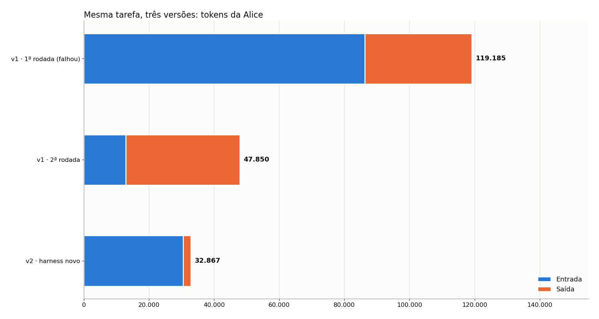
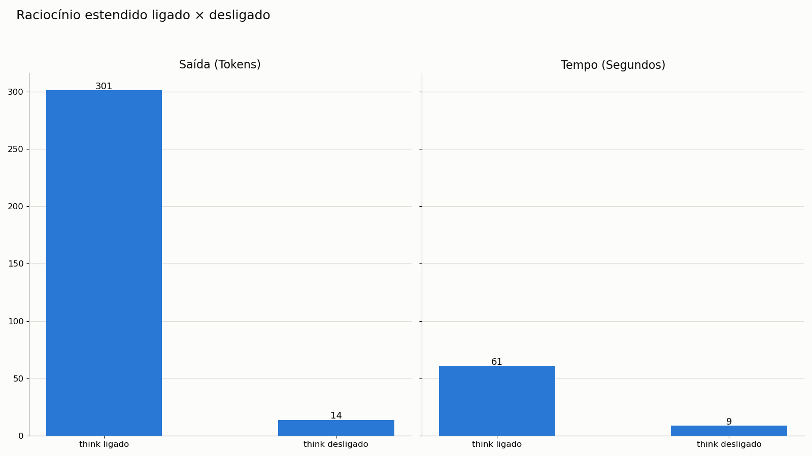
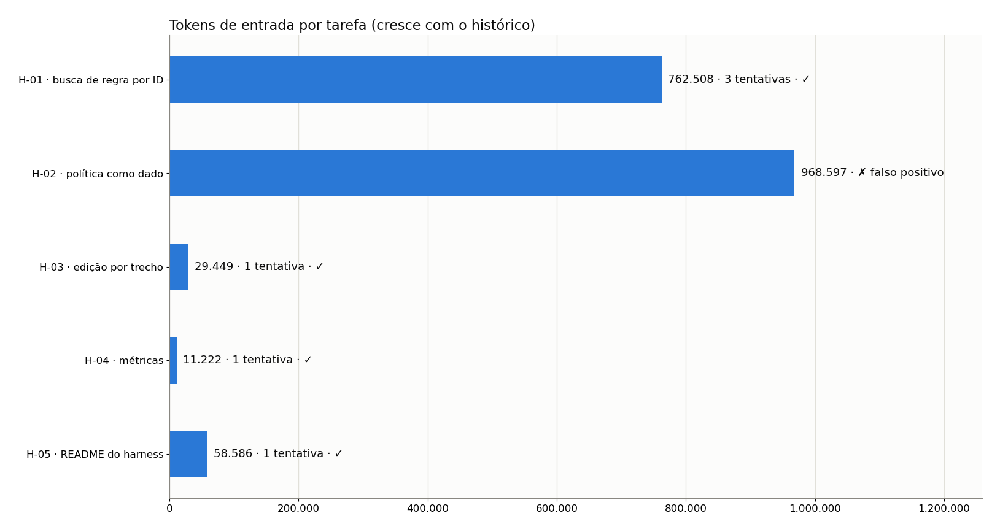
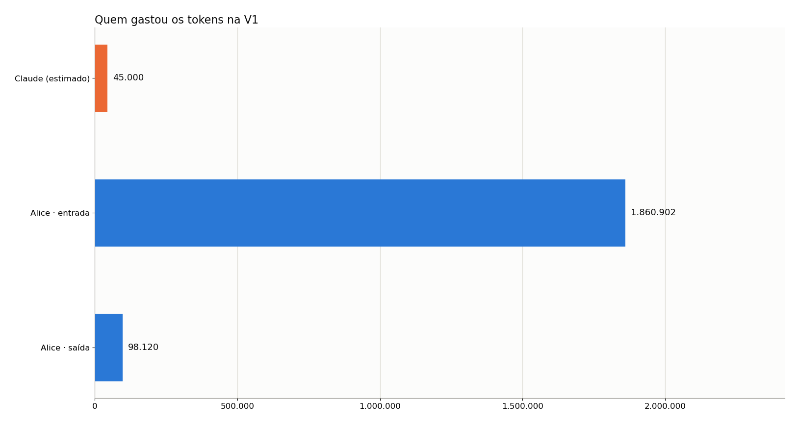

# Claude como tech lead, uma IA local como dev: um harness híbrido para construir software gastando menos tokens

*Parte 1: a fundação. O que montei, como medi, o que deu errado e o que ainda falta provar.*

> **Status:** rascunho vivo (v0, 14/11/2026). As conclusões desta parte são **parciais**: até aqui testei a infraestrutura, o harness e a dinâmica entre os dois modelos. A geração de código do produto (TypeScript, API, banco, frontend) é o assunto da parte 2.

---

## A dor

Comecei com um problema bem concreto: uma planilha de empréstimos cheia de armadilhas. Saldo com sinal digitado à mão, renovação registrada como linha nova, datas de vencimento em texto livre. O plano era trocar a planilha por um sistema de verdade, o **pilla**, e aproveitar o projeto como laboratório: dá para construir software com arquitetura séria usando agentes de IA, sem perder o controle e sem queimar orçamento?

Logo apareceram quatro dores:

1. **Tokens do Claude em trabalho braçal.** O Claude é ótimo para decidir arquitetura e revisar. Mas boa parte do trabalho é tentar, rodar teste, errar, tentar de novo. Fazer isso com o modelo mais caro é desperdício e esgota o limite de uso.
2. **Um modelo local sozinho inventa.** Com um modelo de 12B solto num repositório, você recebe API que não existe e teste "passando" porque alguém mexeu no teste.
3. **Contexto inchado.** Reler 16 mil palavras de documentação a cada tarefa custa caro e piora a resposta.
4. **Uma pessoa só.** Sou eu quem decide, revisa e aprova. Qualquer processo que me puxe para o meio de cada iteração não escala.

Nem "só Claude" nem "só modelo local" resolve as quatro. A aposta foi **dividir o trabalho pelo que cada um faz melhor** e colocar uma camada de travas entre eles.

## O hardware e as peças

| Peça | O quê | Papel |
|---|---|---|
| GPU local | RTX 5070, 12 GB de VRAM, num PC Windows | roda o modelo local de graça (só energia) |
| Modelo local ("Alice") | gemma4 12B via Ollama, contexto de 32 mil tokens | desenvolvedora: implementa, roda testes, corrige |
| Tech lead | Claude (Anthropic) via Claude Code | planeja, escreve testes e travas, revisa, comita |
| Ambiente de desenvolvimento | VM Debian 13 num servidor doméstico com Proxmox | onde o código e o harness vivem; a Alice é chamada pela rede local |
| Busca | API do Brave, limitada a documentação oficial | a Alice consulta docs em vez de chutar |
| Skills | pacote aberto de skills para agentes (MIT), revisado e fixado por commit | diretrizes de código, revisão, DDD, ameaças |

Os 12 GB de VRAM decidem muita coisa. Um modelo de 12B quantizado com 32 mil de contexto cabe inteiro na placa e responde rápido. Modelos maiores (tenho um MoE de 35B e um de 20B para testar) não cabem na VRAM e ficam mais lentos. Por isso a Alice é a **executora**, não a líder: ela é forte em ciclos curtos e bem delimitados, e fraca em decisões abertas. Outra consequência prática: se o PC Windows está desligado, a Alice também está.

## A ideia: supervisor e executora, especificação antes, testes primeiro

Três padrões conhecidos, combinados:

- **Supervisor–Worker (hierárquico):** o Claude supervisiona e a Alice executa. Eu fico em cima, aprovando documentos e PRs.
- **Spec Driven Development:** nada é implementado sem documento aprovado.
- **TDD com separação de papéis:** quem escreve o teste não implementa, e quem implementa não pode tocar no teste.

```text
 Eu (decido e aprovo docs/PRs)
   │
   ▼
 Claude: tech lead ─ cartão de tarefa + testes que falham + travas
   │
   ▼
 Harness ─ ferramentas limitadas, escrita só onde o cartão deixa
   │
   ▼
 Alice (GPU local) ─ lê → implementa → roda testes → corrige → refatora
   │                     (dúvida? doc oficial ou pergunta ao Claude)
   ▼
 Harness ─ verificação final (escopo, diff, todos os checks)
   │
   ▼
 Claude recebe só um relatório compacto → revisa → commit → PR
```

O ponto central de economia: **o ciclo de tentativa e erro acontece inteiro na GPU local.** O Claude não vê as 20 iterações da Alice, só o resultado que passou nas travas: status, arquivos, tentativas, tokens e até três lições aprendidas.

## Documentação antes do código

Antes de qualquer linha de código, o projeto tinha 16,7 mil palavras de documentação:

- **PRD:** o produto, com regras de negócio identificadas (`RN-C03`: arredondamento para múltiplo de R$ 5) e exemplos numéricos (`CA-01`: 5.000 a 6,33% ao mês em 6 parcelas → parcela de 1.150).
- **RFCs:** propostas técnicas, como o motor de cálculo, a API e eventos, e o modelo do banco.
- **13 ADRs:** decisões de arquitetura (dinheiro em centavos inteiros, nada derivado armazenado, módulos com schema próprio).
- **Glossário pt→código e anotações legais**, em seções separadas.

Para um agente, isso é mais que documentação: é **a fonte da verdade que ele pode citar**. Um ID estável vira contrato. O teste cita `CA-01`, o código cita `RN-C03`, e o cartão de tarefa lista as regras pelo ID. Hoje o harness indexa **129 IDs** e injeta no pedido da Alice só o texto das regras da tarefa, não o documento inteiro.

## O harness: ferramentas, travas e "nunca invente"

O harness é um programa Python pequeno (só biblioteca padrão + PyYAML, cerca de 550 linhas) que roda a Alice em cima de um **cartão de tarefa** em YAML. O cartão diz onde ela pode escrever, quais testes estão protegidos, quais comandos provam que terminou e quanto ela pode gastar.

| Trava | Como funciona |
|---|---|
| Ferramentas fechadas | ler e buscar no repositório, escrever, editar trecho, ver o próprio diff, rodar os checks do cartão, buscar em doc oficial, perguntar ao Claude, finalizar. **Sem shell, sem git, sem rede livre** |
| Escrita | só nos caminhos do cartão; testes, docs, configs e o próprio harness são protegidos |
| Segredos | `.env` ilegível para a Alice |
| Verificação final | o ambiente (não a Alice) confere: arquivos alterados dentro do escopo; diff sem `any`, `@ts-ignore`, `eslint-disable`, `.only`, `console.`, TODO sem ID; todos os checks passando |
| Refatoração | com tudo verde, uma rodada obrigatória de limpeza e nova verificação |
| Orçamento | limite de tentativas e de chamadas por cartão |
| "Nunca invente" | dúvida → docs do projeto → doc oficial (lista fechada de domínios) → `ask_claude`, que pausa a tarefa; o Claude devolve só a resposta. Regra de negócio nunca vem da web |
| Política como dado | domínios, arquivos protegidos e padrões proibidos ficam num único `policy.yaml`, lido pelo harness (e, depois, pelo CI) |
| Memória curada | a Alice propõe lições ao terminar; o Claude faz a curadoria num arquivo versionado |
| Porteiro SSH | a chave da Alice só executa comandos do harness e leitura |

Uma decisão que economizou complexidade: **não criei agentes especializados.** Revisor, autor de testes e documentador viraram *modos* da mesma Alice (um campo `kind` no cartão), cada um com instruções e permissões próprias. Cada agente novo custaria contexto e coordenação, e um modo custa uma linha de configuração.

## O que medimos

Os números de tokens da Alice vêm do próprio Ollama. Os do Claude são **estimativas** (texto lido + escrito), e eu sinalizo onde aparecem.


*A mesma tarefa pequena em três momentos. Repare na barra laranja (saída): ela some quando o raciocínio estendido é desligado.*

A tarefa de validação (uma função de arredondamento de 3 linhas) rodou três vezes. Na primeira, a Alice acertou o código, mas o harness reprovou por engano (contou arquivos de cache do Python como "alteração fora do escopo") e ela gastou 4 tentativas. Na segunda, passou de primeira com 48 mil tokens, sendo 35 mil de saída. Com o harness novo, foram **33 mil tokens, 2,3 mil de saída, em 21 segundos**, incluindo a rodada de refatoração.


*Mesma pergunta, mesma resposta correta: 21 vezes menos tokens e quase 7 vezes menos tempo.*

A maior economia não veio de engenharia sofisticada, e sim de **desligar o raciocínio estendido** do modelo em tarefas bem especificadas. Numa pergunta simples, a saída caiu de 301 para 14 tokens e o tempo de 61 para 9 segundos. Quando o teste já diz exatamente o que fazer, pensar em voz alta é desperdício. O harness deixa ligar por cartão, para lógica difícil.


*Tokens de entrada da Alice por tarefa. As duas barras longas são as tarefas com mais idas e vindas.*

Depois coloquei a Alice para construir partes do **próprio harness**: quatro módulos a partir de testes que eu escrevi, mais o README. Três passaram de primeira em até 22 segundos. As duas tarefas longas mostram o calcanhar de Aquiles: **a cada chamada, o histórico inteiro é reenviado ao modelo**. Uma tarefa com 23 chamadas consumiu 762 mil tokens de entrada. Na GPU local isso custa tempo, não dinheiro, mas é o próximo alvo de otimização.


*Na rodada de melhorias, quase todo o volume ficou na GPU local. A barra do Claude é estimada.*

Na rodada de melhorias, o Claude gastou cerca de **45 mil tokens** (estimado) escrevendo testes, revisando e integrando. A Alice processou **1,86 milhão de tokens de entrada e 98 mil de saída**, sem custo de API. Tudo levou uns 21 minutos de relógio.

Outros números:
- O guia dos agentes (`AGENTS.md`) caiu de 2.422 para 1.154 palavras; os detalhes passaram a ser lidos sob demanda.
- O harness tem 27 testes próprios.
- O porteiro SSH: 8 comandos testados, 3 permitidos, 5 negados (inclusive `cat .env` e uma tentativa de encadear comandos).

## O que deu errado

- **O harness errou duas vezes antes da Alice.** Ele contou cache do Python como alteração e acusou o próprio arquivo de política, que guarda os padrões proibidos como dado. Nas duas vezes, a Alice tinha feito o trabalho certo e foi reprovada. Lição: a verificação também precisa de teste.
- **A Alice corrompeu uma regex, e o teste não pegou.** O padrão errado passava nos casos que escrevi por coincidência. Lição: teste de regex precisa de casos que separem o padrão certo de um parecido.
- **A Alice entregou uma detecção de ID frouxa demais:** qualquer célula de tabela com hífen virava "regra", inclusive datas. Os testes passavam, e só a revisão com dados reais mostrou o problema.
- **Eu (o Claude, no caso) quebrei o harness na integração:** apaguei sem querer um filtro. O teste de ponta a ponta pegou na hora.
- **Eu atrapalhei a Alice.** Enquanto ela ajustava os gráficos deste artigo, escrevi arquivos na mesma pasta. A verificação acusou "arquivo fora do escopo" e reprovou a tarefa. Era um risco que a auditoria já apontava (dois agentes na mesma cópia do repositório); agora tem evidência. Próximo passo: uma cópia isolada por tarefa.
- **O modelo local monta mal a chamada de ferramenta quando o argumento é código grande:** pedaços do código "vazavam" para o caminho do arquivo. O harness agora limpa o caminho e, quando falta argumento, responde com a assinatura correta. Na repetição, a tarefa passou de primeira em 45 segundos.
- **O primeiro rascunho deste artigo**, escrito pela Alice, saiu em 22 segundos mas tinha 4 erros factuais e um "contra" que nunca medimos. Virou esqueleto, e a versão final foi reescrita. Texto público ainda precisa de revisão forte.

Em resumo: 5 entregas da Alice, 3 aceitas como vieram ou com ajuste mínimo, 2 com correção do Claude. Todos os erros foram pegos por teste, verificação ou revisão antes de chegar ao repositório.

## Prós e contras (até aqui)

**Prós**
- O trabalho repetitivo sai do orçamento do Claude: ele escreve testes e revisa, a GPU itera.
- As travas são impostas pela máquina, não por promessa: escopo de escrita, testes protegidos, diff varrido, segredos ilegíveis.
- A documentação com IDs vira contexto barato e preciso: regra por ID em vez de documento inteiro.
- A Alice é rápida e gratuita em tarefas bem especificadas (segundos, não minutos).
- O processo gera dados (métricas por tarefa) para calibrar o próprio processo.

**Contras**
- **Custo inicial alto:** muito documento e muito harness antes da primeira linha do produto.
- **A revisão continua indispensável:** 2 de 5 entregas precisaram de correção, e teste fraco deixa passar erro.
- **Dependência do hardware:** sem o PC com GPU ligado, não há Alice.
- **Tarefas longas ficam caras em tempo:** o reenvio do histórico faz a entrada crescer rápido.
- **O harness é mais uma peça para manter**, com bugs próprios (dois falsos positivos até aqui).

## O que ainda não foi testado

- **Geração do código do produto em TypeScript.** Até agora, a Alice só escreveu Python do próprio harness. A parte 2 começa pelo motor financeiro, com os casos de teste já tabelados nos documentos.
- **A Alice escrevendo testes** (modo `test-author`), que é o maior corte previsto no consumo do Claude.
- **Pré-revisão automática, fila de tarefas e CI** com todas as travas (lint, tipos, fronteiras entre módulos, teste de mutação).
- **A comparação justa:** a mesma tarefa feita só pelo Claude, medindo custo, qualidade e tempo. [PENDENTE]

## Conclusões parciais

- **Dividir por competência funciona na fundação.** O Claude decide e revisa, a IA local itera, e o harness impede atalhos.
- **O ganho mais barato veio de configuração**, não de arquitetura: desligar o raciocínio estendido cortou a saída em mais de 90%.
- **Documentação com IDs é infraestrutura para agentes**, não burocracia.
- **Travas e testes também erram:** a verificação precisa ser testada como qualquer código.
- **Ainda não sei se compensa no código de produção.** Essa resposta depende da parte 2. [PENDENTE]

*Na parte 2: a Alice escrevendo o motor financeiro em TypeScript, testes de mutação e a comparação com o Claude fazendo tudo sozinho.*
