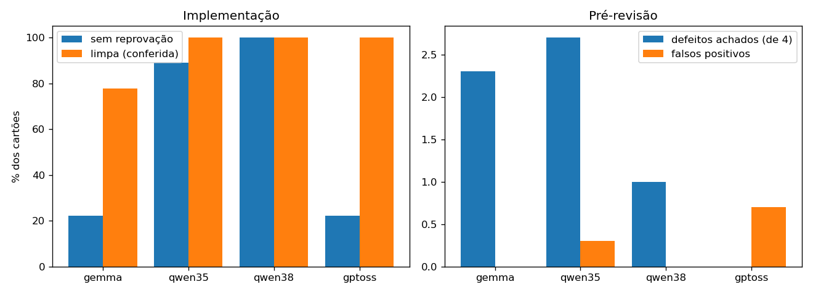
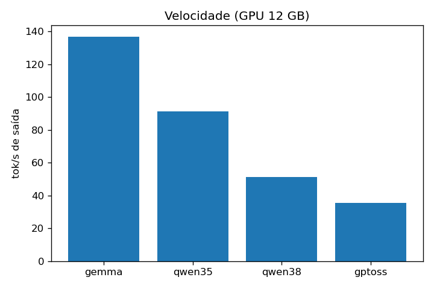

# Bancada de modelos: o mesmo harness em quatro modelos locais

Gerado por `docs/estudo/bancada.py` a partir dos registros do harness. Não edite à mão.
Leitura e conclusões: [bancada/analise.md](bancada/analise.md). Scripts e gabarito: [bancada/scripts/](bancada/scripts/).

## Montagem

- Mesmo harness (`tools/alice-harness`, perfis em `models.yaml`), mesmos cartões, mesma GPU de 12 GB.
- Todos os modelos cabem 100% na GPU com contexto de 32k (o harness compacta em ~28 mil tokens).
- Implementação: E2-T15, E2-T19, E2-T22 a partir dos esboços (`z.never()`) do E2-T13.
- Pré-revisão: E2-T23 sobre os corpos prontos com **4 defeitos plantados** (C3, C4, C5, C7);
  C1, C2 e C6 estão corretos. Nota = itens com o veredito certo (de 7).
- Cada modelo roda várias vezes (temperatura > 0): os números são médias por repetição.

## Comparativo

| Modelo | Rep. | Impl. done | Sem reprovação | Impl. limpa | Reprovações/cartão | s/cartão | Defeitos achados (de 4) | …no arquivo certo | Falsos positivos | Itens certos (de 7) | tok/s |
|---|---|---|---|---|---|---|---|---|---|---|---|
| Gemma 4 12B (Q4_K_M) — linha de base | 3 | 7/9 | 2/9 | 7/9 | 0.8 | 75.1 | 2.3 | 1.7 | 0 | 5.3 | 136.8 |
| Qwen 3.5 9B (Q4_K_M) | 3 | 9/9 | 8/9 | 9/9 | 0.1 | 29.2 | 2.7 | 2.3 | 0.3 | 4.3 | 91.4 |
| Qwen 3.8 27B (UD-IQ2_XXS, ~2 bits) | 3 | 9/9 | 9/9 | 9/9 | 0 | 28.6 | 1 | 1 | 0 | 2 | 51.2 |
| gpt-oss 20B (MXFP4, raciocínio low) | 3 | 9/9 | 2/9 | 9/9 | 0.8 | 70.0 | 0 | 0 | 0.7 | 0.3 | 35.4 |

*Sem reprovação* = o 1º finish já passou na verificação do harness. Toda execução aprovada tem ao menos 2
tentativas, porque depois da aprovação vem uma rodada obrigatória de limpeza; por isso contamos reprovações.
*Impl. limpa* = testes do cartão passam, typecheck ok, `strictObject`, `export type` e nenhum esboço restante
(conferido pelo Claude depois, fora do harness). *No arquivo certo* = a evidência do item cita o arquivo
do defeito (um 'falta' com a prova errada não conta). Itens certos olha só o veredito.

## Gemma 4 12B (Q4_K_M) — linha de base

- Tokens: 3256299 de entrada, 12473 de saída; 136.8 tok/s de saída.
- Pré-revisão: 3/3 done, 30.7 s em média, 0.7 reprovação(ões) por execução.
- Erros 5xx do Ollama absorvidos pelo harness (LI-049): 0.
- Categorias de falha que o harness devolveu: checklist, esboço, teste, vazio; travamentos: 10.

| Rep. | Cartão | Status | Tent. | Chamadas | s | Reprovações (categorias) | Nota |
|---|---|---|---|---|---|---|---|
| r1 | E2-T15 | failed | 2 | 31 | 219.8 | vazio+esboço+teste | esboço, sem export type, sem strict, testes |
| r1 | E2-T19 | done | 2 | 11 | 14.5 | — | limpa |
| r1 | E2-T22 | done | 3 | 15 | 23.0 | esboço | limpa |
| r1 | E2-T23 | done | 3 | 34 | 32.7 | checklist | 6/7; achou C3, C4, C7 (prova errada: C3) |
| r2 | E2-T15 | failed | 2 | 29 | 185.6 | vazio+esboço+teste | esboço, sem export type, sem strict, testes |
| r2 | E2-T19 | done | 2 | 11 | 14.2 | — | limpa |
| r2 | E2-T22 | done | 3 | 15 | 21.7 | esboço | limpa |
| r2 | E2-T23 | done | 3 | 34 | 30.3 | checklist | 5/7; achou C4, C7 (prova errada: C4) |
| r3 | E2-T15 | done | 4 | 27 | 151.8 | vazio+esboço+teste | limpa |
| r3 | E2-T19 | done | 3 | 14 | 22.3 | esboço | limpa |
| r3 | E2-T22 | done | 3 | 16 | 23.3 | esboço | limpa |
| r3 | E2-T23 | done | 1 | 27 | 29.1 | — | 5/7; achou C4, C7 |

## Qwen 3.5 9B (Q4_K_M)

- Tokens: 1945226 de entrada, 27957 de saída; 91.4 tok/s de saída.
- Pré-revisão: 2/3 done, 87.0 s em média, 1.3 reprovação(ões) por execução.
- Erros 5xx do Ollama absorvidos pelo harness (LI-049): 0.
- Categorias de falha que o harness devolveu: checklist, lint, typecheck; travamentos: 0.

| Rep. | Cartão | Status | Tent. | Chamadas | s | Reprovações (categorias) | Nota |
|---|---|---|---|---|---|---|---|
| r1 | E2-T15 | done | 2 | 12 | 41.1 | — | limpa |
| r1 | E2-T19 | done | 2 | 10 | 15.2 | — | limpa |
| r1 | E2-T22 | done | 2 | 10 | 13.9 | — | limpa |
| r1 | E2-T23 | done | 3 | 36 | 62.9 | checklist | 6/7; achou C3, C4, C5, C7; falso positivo C6 |
| r2 | E2-T15 | done | 2 | 10 | 35.2 | — | limpa |
| r2 | E2-T19 | done | 2 | 8 | 14.3 | — | limpa |
| r2 | E2-T22 | done | 2 | 10 | 15.1 | — | limpa |
| r2 | E2-T23 | done | 3 | 50 | 132.9 | checklist → checklist | 7/7; achou C3, C4, C5, C7 (prova errada: C3) |
| r3 | E2-T15 | done | 3 | 14 | 46.8 | typecheck+lint | limpa |
| r3 | E2-T19 | done | 2 | 9 | 14.3 | — | limpa |
| r3 | E2-T22 | done | 3 | 25 | 66.9 | — | limpa |
| r3 | E2-T23 | failed | 3 | 38 | 65.2 | checklist | 0/7; achou nada |

## Qwen 3.8 27B (UD-IQ2_XXS, ~2 bits)

- Tokens: 1061251 de entrada, 13745 de saída; 51.2 tok/s de saída.
- Pré-revisão: 1/3 done, 75.8 s em média, 1.3 reprovação(ões) por execução.
- Erros 5xx do Ollama absorvidos pelo harness (LI-049): 0.
- Categorias de falha que o harness devolveu: checklist; travamentos: 0.

| Rep. | Cartão | Status | Tent. | Chamadas | s | Reprovações (categorias) | Nota |
|---|---|---|---|---|---|---|---|
| r1 | E2-T15 | done | 2 | 13 | 42.4 | — | limpa |
| r1 | E2-T19 | done | 2 | 11 | 24.0 | — | limpa |
| r1 | E2-T22 | done | 2 | 11 | 23.1 | — | limpa |
| r1 | E2-T23 | failed | 3 | 47 | 96.2 | checklist → checklist | 0/7; achou nada |
| r2 | E2-T15 | done | 2 | 14 | 43.0 | — | limpa |
| r2 | E2-T19 | done | 2 | 11 | 20.3 | — | limpa |
| r2 | E2-T22 | done | 2 | 11 | 24.1 | — | limpa |
| r2 | E2-T23 | done | 2 | 32 | 63.1 | checklist | 6/7; achou C3, C4, C7 |
| r3 | E2-T15 | done | 2 | 11 | 37.0 | — | limpa |
| r3 | E2-T19 | done | 2 | 11 | 20.9 | — | limpa |
| r3 | E2-T22 | done | 2 | 11 | 22.4 | — | limpa |
| r3 | E2-T23 | failed | 3 | 33 | 68.1 | checklist | 0/7; achou nada |

## gpt-oss 20B (MXFP4, raciocínio low)

- Tokens: 1162210 de entrada, 21912 de saída; 35.4 tok/s de saída.
- Pré-revisão: 1/3 done, 102.3 s em média, 1.7 reprovação(ões) por execução.
- Erros 5xx do Ollama absorvidos pelo harness (LI-049): 2.
- Categorias de falha que o harness devolveu: checklist, esboço; travamentos: 0.

| Rep. | Cartão | Status | Tent. | Chamadas | s | Reprovações (categorias) | Nota |
|---|---|---|---|---|---|---|---|
| r1 | E2-T15 | done | 2 | 17 | 53.3 | — | limpa |
| r1 | E2-T19 | done | 3 | 16 | 67.0 | esboço | limpa |
| r1 | E2-T22 | done | 3 | 16 | 70.7 | esboço | limpa |
| r1 | E2-T23 | failed | 3 | 26 | 198.7 | checklist → checklist | 0/7; achou nada |
| r2 | E2-T15 | done | 3 | 16 | 104.3 | esboço | limpa |
| r2 | E2-T19 | done | 3 | 22 | 84.1 | esboço | limpa |
| r2 | E2-T22 | done | 3 | 18 | 64.8 | esboço | limpa |
| r2 | E2-T23 | done | 2 | 13 | 47.5 | checklist | 1/7; achou nada; falso positivo C2, C6 |
| r3 | E2-T15 | done | 2 | 18 | 94.5 | — | limpa |
| r3 | E2-T19 | done | 3 | 16 | 50.8 | esboço | limpa |
| r3 | E2-T22 | done | 3 | 15 | 40.7 | esboço | limpa |
| r3 | E2-T23 | failed | 3 | 10 | 60.8 | checklist → checklist | 0/7; achou nada |

## Gabarito da pré-revisão

- C3: D1 centavos sem positiveCentsSchema
- C4: D4 regex de CPF fora de common.ts
- C5: D2 export faltando no index.ts
- C7: D3 z.number().int() (o check acusa)
