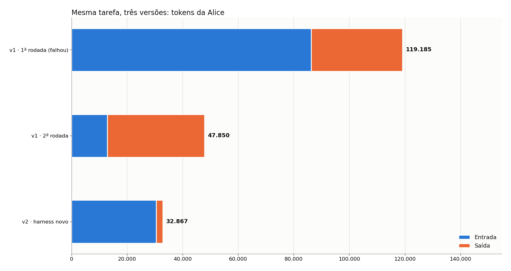

# Linha do tempo

## V0 — Harness experimental

## Contexto

A primeira abordagem dividia o trabalho assim:

```text
humano
  -> decide problema e aprova
Claude
  -> planeja, escreve testes e revisa
harness
  -> limita arquivos, ferramentas e checks
modelo local
  -> implementa e corrige
```

Os artefatos principais eram:

- cartões YAML;
- política de arquivos;
- testes protegidos;
- tools fechadas;
- métricas por execução;
- memória curada;
- documentos PRD/RFC/ADR.

## O que foi aprendido

### Sucesso

- a IA local pode receber tarefas pequenas e bem delimitadas;
- desligar raciocínio estendido reduziu tokens de saída;
- testes escritos antes da implementação ajudaram;
- testes e gates impediram alguns atalhos;
- documentação com IDs estabilizou contratos.

### Problema

- contexto crescia a cada iteração;
- tarefas longas reenvavam o histórico inteiro;
- o modelo falhava em convergir mesmo com muitos ciclos;
- o portão, o teste e o revisor podem ter erros próprios;
- o harness podia produzir falso positivo;
- uma sessão humana ainda coordenava muitos retornos.

### Evidência histórica

- tarefa pequena ligada: 301 tokens de saída e 61 segundos;
- tarefa pequena desligada: 14 tokens de saída e 9 segundos;
- melhoria do harness: uma tarefa caiu de cerca de 119 mil para cerca de 33 mil tokens;
- em uma leva, Alice processou cerca de 1,86 milhão de entrada e 98 mil de saída;
- Claude representou cerca de 45 mil tokens estimados nessa leva.

## V1 — Harness-ada

A reestruturação começou com uma separação mais formal:

- `agent/`: papéis;
- `skill/`: conhecimento reutilizável;
- `gate/`: critérios objetivos;
- `workflow/`: sequência;
- `adapter/`: ferramentas e modelos;
- `script/`: ação determinística;
- `policy/`: regras globais;
- `capability/`: composição de skills, políticas e gates.

A configuração deixou de estar distribuída no código e passou para `harness.project.yaml`.

## Decisões úteis da V1

- agents são papéis, não tecnologias;
- skills são compartilhadas;
- workers são substituíveis;
- workers podem receber um scope de escrita;
- testes são assinados por hash;
- o expect-red roda antes da implementação;
- o estado registra etapas e tentativas;
- a versão atual já reconhece que UI pode ser dispensada de TDD;
- `run_card.py` criou um loop local limitado para trabalhadores.

## V1.1 — Reconhecimento do problema real

O relatório de 20/11 mostrou que o harness já tinha travas reais, mas não era uma linha de produção:

- uma feature parou no refinamento;
- workers baratos não concluíram o plano;
- testes foram revisados manualmente;
- o orquestrador reescreveu ou reconferiu trabalho;
- estado e código divergiram;
- worktrees e stashes vazaram entre sessões;
- uma feature ficou implementada sem fechar todas as etapas.

## V2 — Fábrica controlada por motores

A V2 deve preservar o melhor da V1 e retirar dela o custo que hoje volta ao orquestrador:

- o workflow deixa de ser apenas Markdown;
- o event log passa a registrar transições;
- `estado.json` vira projeção derivável;
- retry e fallback passam ao motor;
- worktrees são criadas por stage;
- evidências substituem afirmações em texto;
- a UI mostra a execução;
- PRD, ADR, RFC e cartões são validados por schemas;
- gates variam conforme o tipo de trabalho.



## Próximo marco

O marco seguinte não é “o modelo ficou mais inteligente”.
É “o motor conseguiu completar uma feature sem o Claude decidir a próxima iteração”.
