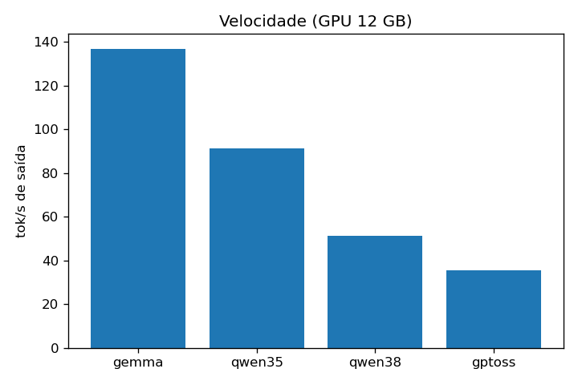
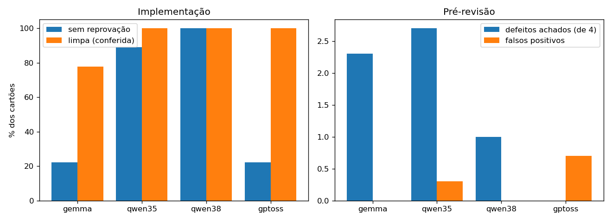

# Custo, autonomia e modelos locais

## Distância entre inteligência e coordenação

O orquestrador não precisa escrever código em todas as etapas.
Ele precisa:

- carregar documentos;
- resolver a próxima stage;
- chamar a engine correta;
- interpretar um schema;
- executar fallback;
- ler um resumo;
- abrir decisões humanas.

Por isso o orquestrador ideal não é necessariamente o maior modelo disponível.

## Benchmarks conhecidos

| Item | Resultado observado |
|---|---|
| Thinking ligado | 301 tokens de saída |
| Thinking desligado | 14 tokens de saída |
| Thinking ligado | 61 segundos |
| Thinking desligado | 9 segundos |
| V1 — to-do toy | cerca de 119 mil tokens |
| V1 — segunda rodada | cerca de 48 mil tokens |
| V2 — harness novo | cerca de 33 mil tokens |

Esses números não são um benchmark universal.
Eles mostram que especificação curta e configuração podem reduzir custo dentro das tarefas observadas.

## O que concentra tokens

Na V1, o custo alto veio de:

- releitura de contexto;
- histórico reenchendo a cada tentativa;
- tarefas com mais idas e vindas;
- reconferência manual pelo orquestrador;
- planos reescritos;
- revisão sem evidência;
- retrabalho por estado sujo.

O custo local é tempo e VRAM.
O custo pago é contexto, saída e retrabalho.

## Qwen 3.5 local

A RTX 5070 mais comum possui 12 GB de VRAM.
A 5070 Ti costuma possuir 16 GB.

Uma Qwen 3.5 pode ser um orquestrador local adequado se:

- o modelo estiver corretamente quantizado;
- o contexto estiver limitado;
- ele receber resumos, não logs inteiros;
- ele tiver schema de saída;
- ele puder usar tools previstas;
- o motor Python fizer as decisões determinísticas;
- existir fallback para modelos maiores.

Não é correto atribuir ao modelo local a responsabilidade de:

- calcular transições;
- interpretar gates pelo texto;
- escolher worktree;
- editar estado;
- commitar;
- decidir política.

Essas responsabilidades devem ficar no Control Plane.

## Arquitetura de modelos sugerida

```yaml
orchestrator:
  primary: qwen-local
  fallback: sonnet-or-claude

test-writer:
  primary: qwen-local
  fallback: sonnet

implementer:
  primary: qwen-local-or-cli-agent
  fallback: sonnet-or-claude

reviewer:
  primary: sonnet-or-claude
  second_opinion: conditional
```

Essa configuração deve ser validada por feature, não escolhida por preferência.

## Métricas necessárias

Medir por feature e por stage:

- tokens de entrada;
- tokens de saída;
- custo estimado;
- duração;
- tentativas;
- fallbacks;
- gate-fails;
- retrabalho;
- diffs rejeitados;
- taxa de aprovação;
- tempo até NEEDS_INPUT;
- tempo até DONE;
- engine usada.

A métrica decisiva não é somente “modelo local terminado”.
É “feature entregue com qualidade e custo total menor”.

## Interrupções humanas

Autonomia não significa remover o humano.

A máquina deve parar para:

- decisão de produto;
- contrato público crítico;
- segredo ou configuração sensível;
- aprovação de release;
- publicação externa;
- risco sem mitigação;
- falta de fallback.

Essas interrupções devem voltar como `NEEDS_INPUT`, com:

- pergunta objetiva;
- opções;
- recomendação padrão;
- artefato afetado;
- custo da espera;
- como retomar.




