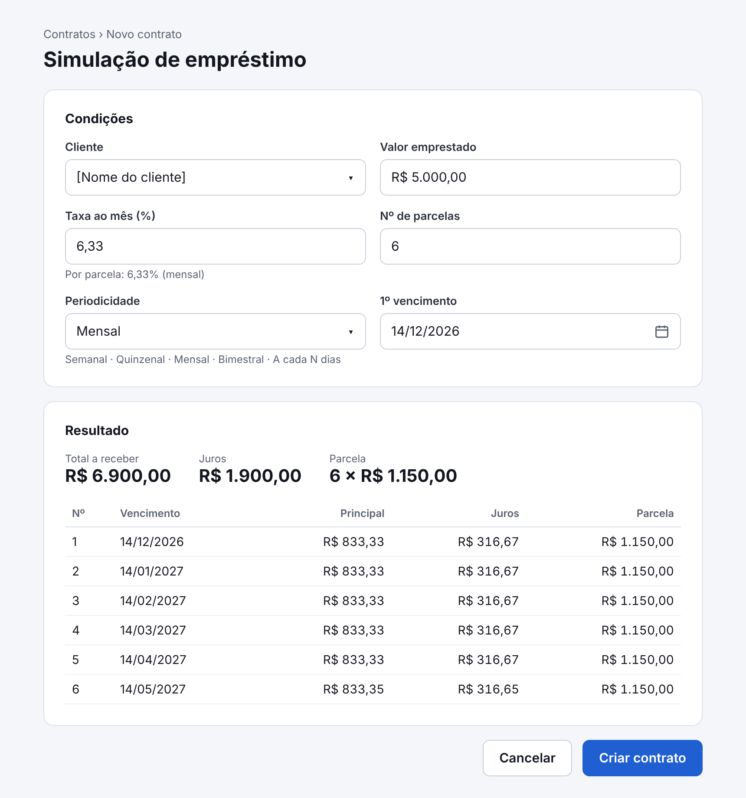

# [E6-F01] Lógica de simulação de empréstimo no lado do navegador

<!-- ada-feature:E6-F01 -->

> Entrega **E6** · Etapa: done · Progresso: 100%
> Gerado dos docs do repositório; não edite à mão (o próximo sync sobrescreve).

## Resumo e escopo

- E6-T01 (Bia): testes de `apps/web/lib/simulation.ts`. Três cartões da Alice, em sequência, protegem o mesmo
  teste: E6-T02 `frequencyOf` (opção da tela → periodicidade do motor; check só com `-t frequencyOf`), E6-T07
  `simulate` (corpo `SimulateLoanRequest` → juros, total, parcela e cronograma via `generateSchedule`; check só com
  `-t simulate`, stub mantido) e E6-T09 (remove o stub e a exclusão do `vitest.config.ts`; arquivo inteiro com
  cobertura 100%).
- E6-T07 refeito em 17/11 depois de duas falhas (21 e 24 chamadas): lê só `simulation.ts`, recebe os tipos e as
  assinaturas na dica e escreve só nesse arquivo. O comentário do stub não fala mais em "1ª parcela": o valor da
  parcela é o mesmo em todas (RN-C03), sem leitura por índice nem desestruturação (o desvio do `undefined` ficaria
  sem cobertura no E6-T09). Não há teste de função auxiliar, então `simulate` fica num cartão só; dividir exige
  testes novos da Bia (decisão do Joel). O E6-T06 passa a depender do E6-T09, fim da cadeia.
- E6-T03 (Bia) e E6-T04 (Alice, depois do E6-T09): `apps/web/lib/simulation-form.ts`, com `toSimulateRequest`
  (textos da tela → `SimulateLoanRequest`, validado por `simulateLoanRequest`).
- Fora: modalidade SINGLE_PAYMENT na tela, "a cada N dias" livre, "Por parcela: x%" (`taxa_do_periodo` não existe
  no motor e o arredondamento para periodicidade em dias não está definido), campo Cliente, criar contrato.

## Regras e critérios

- **RF-10** ADMIN **simula** um empréstimo (principal, taxa, nº de parcelas, modalidade, data do 1º vencimento e periodicidade negociadas) e vê total, parcelas e cronograma, sem gravar.
- Esboço da tela (MVP, simples): [telas/simulacao-contrato.png](https://github.com/fsilvajoel/pilla/blob/main/docs/prd/telas/simulacao-contrato.png?raw=true)

- **CA-11** 1.000,00 a 10% a.m., semanal, 4 parcelas — fator 7/30; juros 93,33 → 95; 1.095 ÷ 4 = 273,75 → parcela 275,00; total 1.100,00

- A1: o exemplo da RFC-004 §5 dá juros 1.900,00, total 6.900,00, parcela 1.150,00 e 6 linhas; a 1ª vence em
  2026-12-14 com principal 833,33 e juros 316,67.
- A2: o CA-11 do PRD-001 (1.000,00 a 10% a.m., semanal, 4 parcelas) dá parcela 275,00 e total 1.100,00.
  O "juros 95" do CA-11 é o valor antes do arredondamento da parcela; `interest` aqui é a soma dos juros das
  parcelas (total menos principal), por isso não entra no teste.
- A3: Semanal = 7 dias, Quinzenal = 15 dias, Mensal = 1 mês, Bimestral = 2 meses (exemplos da RN-C04).
- A4: os textos "5.000,00" e "6,33" viram 500000 e 633 no corpo; texto fora do formato lança erro.
- A6: 1º vencimento igual ou anterior ao desembolso lança `DueDateError` (RN-C04).

## Contrato

_Sem contrato no plano._

## Cartões

### E6-T01 — Escreva os testes para frequencyOf e simulate

- Tipo: `test-author` · Responsável: `bia` · Estado: done

**DoR (pronto para começar)**
- Depende de: nenhuma
- Referências: [PRD-001 RF-10](https://github.com/fsilvajoel/pilla/blob/main/docs/prd/PRD-001-mvp-gestao-emprestimos.md), [RFC-004 §5](https://github.com/fsilvajoel/pilla/blob/main/docs/rfc/RFC-004-api-e-eventos.md), [RFC-002 §3.4](https://github.com/fsilvajoel/pilla/blob/main/docs/rfc/RFC-002-motor-de-calculo-financeiro.md), [ADR-0013](https://github.com/fsilvajoel/pilla/blob/main/docs/adr/0013-estado-no-frontend.md)
- Ler antes: `apps/web/lib/simulation.ts`, `packages/schemas/src/api/lending/simulate-loan.ts`, `packages/schemas/src/common.ts`, `packages/finance/src/index.ts`, `packages/finance/src/schedule.ts`
- Skills: `escrever-teste`

**DoD (definição de pronto)**
- todos os testes falham atualmente contra o stub em HEAD e passariam com uma implementação correta (run_check 0)
- import { describe, expect, it } from "vitest";
- import { DueDateError, isoDate } from "@pilla/finance";
- import type { SimulateLoanRequest } from "@pilla/schemas";
- import { frequencyOf, simulate } from "./simulation";
- frequencyOf retorna { unit: "DAY", interval: 7 } para WEEKLY, dia 15 para BIWEEKLY, { unit: "MONTH", interval: 1 } para MONTHLY e mês 2 para BIMONTHLY (RN-C04 de PRD-001)
- o exemplo de RFC-004 §5 com disbursementDate 2026-11-14 resulta em interest 190000n, total 690000n e installmentAmount 115000n (RFC-004 §5)
- nesse exemplo, o schedule tem comprimento 6 e schedule[0] deve ser igual a { number: 1, dueDate: "2026-12-14", principal: 83333n, interest: 31667n, total: 115000n } (RFC-004 §5)
- CA-11 (principalCents 100000, 1000 bps, 4 parcelas, DAY 7) resulta em installmentAmount 27500n e total 110000n (PRD-001 CA-11)
- simulate deve lançar DueDateError quando firstDueDate é igual a disbursementDate, ambos 2026-11-14 (RN-C04 de PRD-001)
- nunca edite apps/web/lib/simulation.ts
- Pode alterar: `apps/web/lib/simulation.test.ts`
- Verificações:
  - `! pnpm --filter @pilla/web exec vitest run lib/simulation.test.ts`
  - `node scripts/check-test-quality.mjs apps/web/lib/simulation.test.ts`
  - `pnpm --filter @pilla/web typecheck`
  - `pnpm --filter @pilla/web lint`

**Dicas**
- as linhas de import do done são os únicos imports do arquivo; cada nome nelas é utilizado e nada mais é importado
- SimulateLoanRequest é inferido a partir de zod, veja common.ts, portanto principalCents, monthlyInterestRateBps e installmentCount são plain number e firstDueDate é plain string
- construa cada request como um const tipado SimulateLoanRequest com literais plain number como 500000 e 633, nunca envoltos em cents, bps ou isoDate
- a solicitação RFC-004 §5 é do tipo INSTALLMENT, principalCents 500000, monthlyInterestRateBps 633, installmentCount 6, frequency MONTH 1, firstDueDate 2026-12-14
- a solicitação CA-11 é do tipo INSTALLMENT, principalCents 100000, monthlyInterestRateBps 1000, installmentCount 4, frequency DAY 7, firstDueDate 2026-11-21
- cada chamada simulate passa isoDate de 2026-11-14 como segundo argumento, pois disbursementDate é IsoDate, a única entrada brandida do arquivo
- interest, total e installmentAmount são Cents, um bigint brandido, portanto compare-os com toBe contra um literal bigint como 190000n
- as linhas de schedule são ScheduledInstallment de schedule.ts com os campos number, dueDate, principal, interest e total, não os nomes principalCents do esquema da API
- CA-11 afirma apenas installmentAmount e total, nunca interest, conforme o plano indica em A2
- o caso de erro espalha a solicitação RFC-004 §5 com firstDueDate 2026-11-14 e passa DueDateError para toThrow
- um write_file do arquivo de teste inteiro, seguido de run_check 0, 1, 2 e 3

### E6-T03 — Escreva os testes para toSimulateRequest

- Tipo: `test-author` · Responsável: `bia` · Estado: done

**DoR (pronto para começar)**
- Depende de: nenhuma
- Referências: [PRD-001 RF-10](https://github.com/fsilvajoel/pilla/blob/main/docs/prd/PRD-001-mvp-gestao-emprestimos.md), [RFC-004 §5](https://github.com/fsilvajoel/pilla/blob/main/docs/rfc/RFC-004-api-e-eventos.md), [ADR-0013](https://github.com/fsilvajoel/pilla/blob/main/docs/adr/0013-estado-no-frontend.md)
- Ler antes: `apps/web/lib/simulation-form.ts`, `apps/web/lib/simulation.ts`, `packages/schemas/src/api/lending/simulate-loan.ts`, `packages/schemas/src/common.ts`, `packages/finance/src/money.ts`
- Skills: `escrever-teste`

**DoD (definição de pronto)**
- todos os testes falham atualmente contra o stub em HEAD e passariam com uma implementação correta (run_check 0)
- import { describe, expect, it } from "vitest";
- import { MoneyError } from "@pilla/finance";
- import { ZodError } from "zod";
- import type { SimulationFormValues } from "./simulation-form";
- import { toSimulateRequest } from "./simulation-form";
- o formulário RFC-004 §5 fornece a toEqual { type: "INSTALLMENT", principalCents: 500000, monthlyInterestRateBps: 633, installmentCount: 6, frequency: { unit: "MONTH", interval: 1 }, firstDueDate: "2026-12-14" } (RFC-004 §5)
- a taxa mensal "10,00" resulta em monthlyInterestRateBps 1000 e WEEKLY resulta em frequency { unit: "DAY", interval: 7 } (PRD-001 CA-11)
- o valor "5000" sem vírgula lança MoneyError (formato parseReais da RFC-004 §2)
- installmentCount "0" lança ZodError (simulateLoanRequest de ADR-0013)
- nunca editar apps/web/lib/simulation-form.ts
- Pode alterar: `apps/web/lib/simulation-form.test.ts`
- Verificações:
  - `! pnpm --filter @pilla/web exec vitest run lib/simulation-form.test.ts`
  - `node scripts/check-test-quality.mjs apps/web/lib/simulation-form.test.ts`
  - `pnpm --filter @pilla/web typecheck`
  - `pnpm --filter @pilla/web lint`

**Dicas**
- as linhas de import do done são os únicos imports do arquivo; cada nome nelas é utilizado e nada mais é importado
- toSimulateRequest retorna SimulateLoanRequest, cujos principalCents, monthlyInterestRateBps e installmentCount são números simples, portanto o literal esperado possui 500000 e 633, nunca 500000n
- cada formulário é uma const tipada como SimulationFormValues, com texto nos campos amount, monthlyRate, installmentCount e firstDueDate, e um FrequencyPreset no campo frequency
- o formulário RFC-004 §5 possui amount 5.000,00, monthlyRate 6,33, installmentCount 6, frequency MONTHLY e firstDueDate 2026-12-14
- o formulário CA-11 possui amount 1.000,00, monthlyRate 10,00, installmentCount 4, frequency WEEKLY e firstDueDate 2026-11-21
- cada caso de erro espalha o formulário RFC-004 §5 alterando apenas um campo e passa a classe de erro para toThrow
- um write_file do arquivo de teste inteiro, seguido de run_check 0, 1, 2 e 3

### E6-T02 — Implementar frequencyOf

- Tipo: `implement` · Responsável: `alice` · Estado: done

**DoR (pronto para começar)**
- Depende de: `E6-T01`
- Referências: [PRD-001 RF-10](https://github.com/fsilvajoel/pilla/blob/main/docs/prd/PRD-001-mvp-gestao-emprestimos.md), [ADR-0013](https://github.com/fsilvajoel/pilla/blob/main/docs/adr/0013-estado-no-frontend.md)
- Ler antes: `apps/web/lib/simulation.ts`, `packages/finance/src/due-dates.ts`
- Skills: `editar-arquivo`, `coding-guidelines`

**DoD (definição de pronto)**
- os quatro testes de describe frequencyOf em apps/web/lib/simulation.test.ts passam (run_check 0)
- frequencyOf fornece, para cada FrequencyPreset, a unidade e o intervalo listados no comentário /** */ (RN-C04)
- o parâmetro de frequencyOf perde o sublinhado inicial e sua assinatura mantém os tipos FrequencyPreset e Frequency
- simulate permanece exatamente como em HEAD, ainda lançando not implemented, pois é tarefa do E6-T07
- simulation.ts mantém a linha '// @stub E6-T02', as linhas de importação de tipo, os tipos e os comentários /** */ inalterados
- Pode alterar: `apps/web/lib/simulation.ts`
- Testes protegidos: `apps/web/lib/simulation.test.ts`
- Verificações:
  - `pnpm --filter @pilla/web exec vitest run lib/simulation.test.ts -t frequencyOf`
  - `pnpm --filter @pilla/web typecheck`
  - `pnpm --filter @pilla/web lint`

**Dicas**
- apenas o corpo e o nome do parâmetro de frequencyOf mudam, e simulation.ts não recebe nova linha de importação
- Frequency em due-dates.ts é uma interface com unit readonly DAY ou MONTH e interval readonly number, já importado como tipo
- cada preset recebe um literal de objeto com unit e interval, conforme o comentário /** */ de frequencyOf os lista
- o check executa apenas os testes frequencyOf, portanto os testes simulate não fazem parte deste card
- uma edição em simulation.ts que substitui toda a função frequencyOf, seguido da execução de run_check 0, 1 e 2

### E6-T07 — Implementar simulate

- Tipo: `implement` · Responsável: `bia` · Estado: done

**DoR (pronto para começar)**
- Depende de: `E6-T02`
- Referências: [PRD-001 RF-10](https://github.com/fsilvajoel/pilla/blob/main/docs/prd/PRD-001-mvp-gestao-emprestimos.md), [RFC-002 §3.4](https://github.com/fsilvajoel/pilla/blob/main/docs/rfc/RFC-002-motor-de-calculo-financeiro.md), [RFC-004 §5](https://github.com/fsilvajoel/pilla/blob/main/docs/rfc/RFC-004-api-e-eventos.md), [PRD-001 CA-11](https://github.com/fsilvajoel/pilla/blob/main/docs/prd/PRD-001-mvp-gestao-emprestimos.md), [ADR-0013](https://github.com/fsilvajoel/pilla/blob/main/docs/adr/0013-estado-no-frontend.md)
- Ler antes: `apps/web/lib/simulation.ts`
- Skills: `editar-arquivo`, `coding-guidelines`

**DoD (definição de pronto)**
- os quatro testes do describe simulate em apps/web/lib/simulation.test.ts passam (run_check 0)
- import { bps, cents, generateSchedule, isoDate } from "@pilla/finance";
- simulate chama generateSchedule com o tipo INSTALLMENT, count igual a installmentCount, a frequência do request, disbursementDate e roundingStep 500n (RN-C03)
- principalCents e monthlyInterestRateBps tornam-se Cents e Bps através de BigInt e depois cents e bps, nunca com as
- firstDueDate é texto simples no request e torna-se IsoDate através de isoDate antes de chegar a generateSchedule
- interest, total e installmentAmount são valores do tipo Cents calculados em centavos, enquanto schedule é o array gerado pela função generateSchedule.
- simulate não utiliza if, ternário (?? ou ?), try nem catch; portanto, um erro proveniente de generateSchedule, como DueDateError de RN-C04, propaga-se sem tratamento.
- simulation.ts mantém a linha '// @stub E6-T02', as variáveis frequencyOf, as linhas de importação do tipo, os tipos e os comentários /** */.
- os parâmetros de simulate perdem o sublinhado (underscore), sendo que a linha de importação de done é a única nova linha inserida fora da função simulate.
- Pode alterar: `apps/web/lib/simulation.ts`
- Testes protegidos: `apps/web/lib/simulation.test.ts`
- Verificações:
  - `pnpm --filter @pilla/web exec vitest run lib/simulation.test.ts -t simulate`
  - `pnpm --filter @pilla/web typecheck`
  - `pnpm --filter @pilla/web lint`

**Dicas**
- o único arquivo lido é apps/web/lib/simulation.ts, pois todos os tipos e assinaturas necessários estão presentes nestas dicas.
- a assinatura permanece conforme em HEAD, com parâmetro request do tipo SimulateLoanRequest, parâmetro disbursementDate do tipo IsoDate e tipo de retorno SimulationResult.
- a linha de importação de done é inserida imediatamente após a linha '// @stub E6-T02', acima das duas linhas de importação de tipo que permanecem inalteradas.
- cents recebe um bigint e retorna Cents, bps recebe um bigint e retorna Bps, e isoDate recebe uma string e retorna IsoDate, todos provenientes de @pilla/finance
- generateSchedule recebe um objeto com type, count, principal, monthlyInterestRate, firstDueDate, frequency, disbursementDate e roundingStep e retorna ScheduledInstallment[]
- cada ScheduledInstallment possui number, dueDate, principal, interest e total, sendo os três últimos do tipo Cents
- SimulateLoanRequest de @pilla/schemas tem type, principalCents, monthlyInterestRateBps, installmentCount, frequency e firstDueDate, com tipos plain number e string
- request.frequency já possui a forma de Frequency, portanto é passado diretamente para generateSchedule
- interest e total são somas ao longo das linhas, e a adição de dois Cents resulta em um bigint simples; assim, cada soma passa pela conversão para cents antes de entrar no resultado
- nunca leia uma linha por índice ou por destructuring, pois o tsconfig estrito pode torná-la undefined e sua guarda resultaria em um ramo que nenhum teste alcança
- RN-C03 afirma que todo parcelamento tem o mesmo total; portanto, installmentAmount é derivado do total e da quantidade de linhas, ambos bigint
- escreva apenas apps/web/lib/simulation.ts, já que apps/web/lib/simulation.test.ts está protegido e nenhum outro arquivo requer alterações
- Uma edição em um arquivo de simulation.ts que adiciona a linha de import, uma substituição da função simulate, seguido da execução dos checks 0, 1 e 2.

### E6-T09 — Remover o esqueleto (stub) da simulação e verificar a cobertura total.

- Tipo: `implement` · Responsável: `alice` · Estado: done

**DoR (pronto para começar)**
- Depende de: `E6-T07`
- Referências: [PRD-001 RF-10](https://github.com/fsilvajoel/pilla/blob/main/docs/prd/PRD-001-mvp-gestao-emprestimos.md), [ADR-0013](https://github.com/fsilvajoel/pilla/blob/main/docs/adr/0013-estado-no-frontend.md)
- Ler antes: `apps/web/lib/simulation.ts`, `apps/web/vitest.config.ts`
- Skills: `editar-arquivo`, `coding-guidelines`

**DoD (definição de pronto)**
- Todos os testes em apps/web/lib/simulation.test.ts passam com 100% de cobertura de linha e ramo de simulation.ts (run_check 0).
- simulation.ts não possui a linha '// @stub E6-T02' e apps/web/vitest.config.ts não possui nenhuma linha que exclua lib/simulation.ts (run_check 3).
- import { bps, cents, generateSchedule, isoDate } from "@pilla/finance";
- frequencyOf e simulate mantêm o comportamento fornecido por E6-T02 e E6-T07, e todas as outras linhas dos dois arquivos permanecem intactas.
- Pode alterar: `apps/web/lib/simulation.ts`, `apps/web/vitest.config.ts`
- Testes protegidos: `apps/web/lib/simulation.test.ts`
- Verificações:
  - `pnpm --filter @pilla/web exec vitest run lib/simulation.test.ts --coverage --coverage.include=lib/simulation.ts --coverage.exclude=none --coverage.thresholds.lines=100 --coverage.thresholds.branches=100`
  - `pnpm --filter @pilla/web typecheck`
  - `pnpm --filter @pilla/web lint`
  - `! grep -n "stub E6-T02" apps/web/lib/simulation.ts apps/web/vitest.config.ts`

**Dicas**
- E6-T02 e E6-T07 já implementaram o código; portanto, este cartão apenas remove duas linhas e executa a verificação completa.
- A linha em vitest.config.ts a ser removida é aquela dentro de coverage.exclude referente a lib/simulation.ts e o comentário do stub E6-T02, enquanto a linha de lib/simulation-form.ts logo abaixo permanece intacta.
- Se run_check 0 mostrar uma linha ou ramo de simulation.ts não coberto, corrija essa linha em simulation.ts para que não possua mais ramo, pois o arquivo de teste é protegido e nunca alterado.
- editar um arquivo simulation.ts para remover a linha '// @stub E6-T02', editar um arquivo apps/web/vitest.config.ts para remover a linha referente ao stub E6-T02, em seguida executar as verificações 0, 1, 2 e 3

### E6-T04 — Implementar toSimulateRequest

- Tipo: `implement` · Responsável: `alice` · Estado: done

**DoR (pronto para começar)**
- Depende de: `E6-T03`, `E6-T09`
- Referências: [PRD-001 RF-10](https://github.com/fsilvajoel/pilla/blob/main/docs/prd/PRD-001-mvp-gestao-emprestimos.md), [RFC-004 §5](https://github.com/fsilvajoel/pilla/blob/main/docs/rfc/RFC-004-api-e-eventos.md), [ADR-0013](https://github.com/fsilvajoel/pilla/blob/main/docs/adr/0013-estado-no-frontend.md)
- Ler antes: `apps/web/lib/simulation-form.ts`, `apps/web/lib/simulation.ts`, `packages/schemas/src/api/lending/simulate-loan.ts`, `packages/finance/src/money.ts`
- Skills: `editar-arquivo`, `coding-guidelines`

**DoD (definição de pronto)**
- todos os testes em apps/web/lib/simulation-form.test.ts passam com 100% de cobertura de linha e ramo de simulation-form.ts (executar verificação 0)
- importar { parseReais } de "@pilla/finance";
- importar { simulateLoanRequest } de "@pilla/schemas";
- importar { frequencyOf } de "./simulation";
- amount e monthlyRate passam por parseReais, frequency por frequencyOf e o objeto inteiro por simulateLoanRequest.parse
- principalCents, monthlyInterestRateBps e installmentCount chegam a simulateLoanRequest.parse como número, e firstDueDate como o texto digitado no formulário
- manter a interface, a assinatura e os comentários /** */ inalterados, exceto que o parâmetro perde o sublinhado inicial
- simulation-form.ts não possui a linha '// @stub E6-T04' e apps/web/vitest.config.ts não possui uma linha que exclui lib/simulation-form.ts (run_check 3)
- Pode alterar: `apps/web/lib/simulation-form.ts`, `apps/web/vitest.config.ts`
- Testes protegidos: `apps/web/lib/simulation-form.test.ts`
- Verificações:
  - `pnpm --filter @pilla/web exec vitest run lib/simulation-form.test.ts --coverage --coverage.include=lib/simulation-form.ts --coverage.exclude=none --coverage.thresholds.lines=100 --coverage.thresholds.branches=100`
  - `pnpm --filter @pilla/web typecheck`
  - `pnpm --filter @pilla/web lint`
  - `! grep -n "stub E6-T04" apps/web/lib/simulation-form.ts apps/web/vitest.config.ts`

**Dicas**
- as linhas de import type de simulation-form.ts permanecem como estão, ao lado das três linhas de import do feito
- parseReais fornece Cents, um bigint, e Number o converte no número que o esquema da requisição espera, e installmentCount é texto que Number também converte em um número
- uma write_file de simulation-form.ts, seguida de uma edit_file de apps/web/vitest.config.ts que remove a linha com o stub E6-T04, e depois run_check 0, 1, 2 e 3

## Referências

- PRD: [docs/prd/PRD-001-mvp-gestao-emprestimos.md](https://github.com/fsilvajoel/pilla/blob/main/docs/prd/PRD-001-mvp-gestao-emprestimos.md)
- [RFC-004 §5](https://github.com/fsilvajoel/pilla/blob/main/docs/rfc/RFC-004-api-e-eventos.md)
- [RFC-002 §3.4](https://github.com/fsilvajoel/pilla/blob/main/docs/rfc/RFC-002-motor-de-calculo-financeiro.md)
- [ADR-0013](https://github.com/fsilvajoel/pilla/blob/main/docs/adr/0013-estado-no-frontend.md)
- plano.md: [docs/plano/E6-F01/plano.md](https://github.com/fsilvajoel/pilla/blob/main/docs/plano/E6-F01/plano.md)
- revisao.md: [docs/plano/E6-F01/revisao.md](https://github.com/fsilvajoel/pilla/blob/main/docs/plano/E6-F01/revisao.md)
- testes.md: [docs/plano/E6-F01/testes.md](https://github.com/fsilvajoel/pilla/blob/main/docs/plano/E6-F01/testes.md)

## Telas

## Estado

- Etapa: done
- Progresso: 100%
- Bloqueio: não
- `E6-T01`: done
- `E6-T03`: done
- `E6-T02`: done
- `E6-T07`: done
- `E6-T09`: done
- `E6-T04`: done
