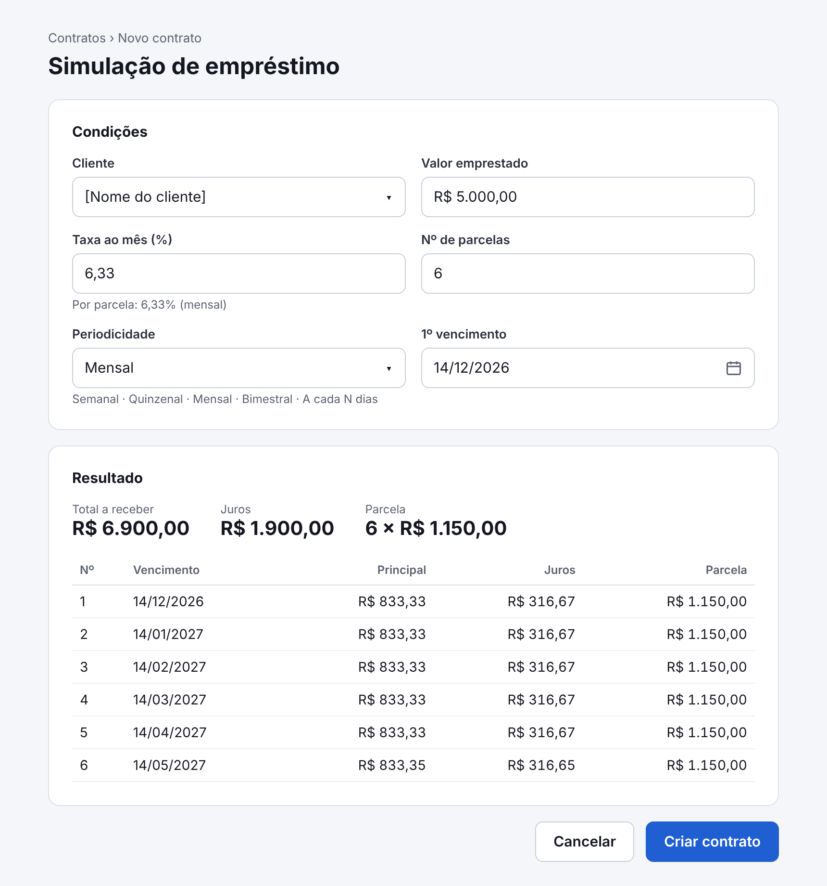

# [E6-F02] Componente de simulação de empréstimo

<!-- ada-feature:E6-F02 -->

> Entrega **E6** · Etapa: done · Progresso: 100%
> Gerado dos docs do repositório; não edite à mão (o próximo sync sobrescreve).

## Resumo e escopo

Entra o componente `LoanSimulation`, que é a tela onde o ADMIN simula um empréstimo sem gravar nada (PRD-001 RF-10).
Ele recebe os campos do formulário, calcula no navegador com `simulate` e `toSimulateRequest` (E6-F01, ADR-0013) e
mostra o resumo (total, juros e parcela) e o cronograma. Para entrada inválida, mostra um alerta no lugar do resultado.

Entra também o primeiro e2e real (Playwright) da rota `/emprestimos/simular`.

Fica de fora:
- a página `apps/web/app/(admin)/emprestimos/simular/page.tsx`, que já existe e não muda;
- `todayInBrt` (`apps/web/lib/today.ts`), que pertence à E7-F01 (E7-T02);
- as regras de cálculo e de leitura do formulário (E6-F01) e os defeitos D1 a D3, que são da E6-F01;
- gravar o contrato e chamar a API.

Arquivos alterados: `apps/web/components/loan-simulation.tsx` (implementação),
`apps/web/components/loan-simulation.test.tsx` e `apps/web/e2e/loan-simulation.e2e.ts` (testes, etapa 2).

## Regras e critérios

- **RF-10** ADMIN **simula** um empréstimo (principal, taxa, nº de parcelas, modalidade, data do 1º vencimento e periodicidade negociadas) e vê total, parcelas e cronograma, sem gravar.
- Esboço da tela (MVP, simples): [telas/simulacao-contrato.png](https://github.com/fsilvajoel/pilla/blob/main/docs/prd/telas/simulacao-contrato.png?raw=true)

### A1: a tela mostra os campos e o botão
- entrada: render de `LoanSimulation` com `disbursementDate` `2026-11-14`
- domínio: todas as entradas da tabela
- saída: campos com os rótulos "Valor emprestado", "Taxa ao mês (%)", "Nº de parcelas", "Periodicidade" (4 opções:
  Semanal, Quinzenal, Mensal e Bimestral) e "1º vencimento"; botão "Simular"
- erro: nenhum
- fonte: PRD-001 RF-10
- camada: unit

### A2: simular mostra o resumo e o cronograma
- entrada: valor `5.000,00`, taxa `6,33`, parcelas `6`, Mensal, 1º vencimento `2026-12-14`, desembolso `2026-11-14`;
  e CA-11: valor `1.000,00`, taxa `10,00`, parcelas `4`, Semanal, 1º vencimento `2026-11-21`
- domínio: valores válidos de todas as entradas
- saída: RFC-004 §5 → "Total a receber" `R$ 6.900,00`, "Juros" `R$ 1.900,00`, "Parcela" `6 × R$ 1.150,00`, tabela
  com 6 linhas e a 1ª linha `1`, `14/12/2026`, `833,33`, `316,67`, `1.150,00`; CA-11 → "Parcela" `4 × R$ 275,00`,
  "Total a receber" `R$ 1.100,00`
- erro: nenhum
- fonte: RFC-004 §5; PRD-001 RF-10, CA-11
- camada: unit

### A3: entrada inválida mostra o alerta sem resultado
- entrada: o exemplo da RFC-004 §5 com um campo trocado por um valor rejeitado
- domínio: exemplos rejeitados de valor, taxa, parcelas e 1º vencimento
- saída: um `role="alert"` com o texto "Confira os campos da simulação." e nenhum "Total a receber" nem tabela
- erro: MoneyError, ZodError ou DueDateError tratados pela tela (nada é lançado para fora)
- fonte: PRD-001 RN-C04; RFC-004 §5; `simulateLoanRequest`
- camada: unit

### A4: a rota /emprestimos/simular simula de ponta a ponta
- entrada: navegador em `/emprestimos/simular`; exemplo da RFC-004 §5 com 1º vencimento `2099-12-14`; depois o mesmo
  exemplo com 1º vencimento `2000-01-14`
- domínio: valores válidos; 1º vencimento anterior a hoje (BRT)
- saída: heading "Simular empréstimo"; com 2099-12-14, "Total a receber" `R$ 6.900,00`, "Juros" `R$ 1.900,00` e
  "Parcela" `6 × R$ 1.150,00`; com 2000-01-14, o alerta "Confira os campos da simulação."
- erro: DueDateError (vira alerta) para a data passada
- fonte: PRD-001 RF-10, RN-C04; decisoes-2026-11-17 §2; RFC-004 §5
- camada: e2e

## Contrato

- `apps/web/components/loan-simulation.tsx`: `export interface LoanSimulationProps { readonly disbursementDate: IsoDate }`
- `apps/web/components/loan-simulation.tsx`: `export function LoanSimulation({ disbursementDate }: LoanSimulationProps): JSX.Element`

Tela (textos exatos):
- campos com rótulo: "Valor emprestado", "Taxa ao mês (%)", "Nº de parcelas", "Periodicidade" (select com as opções
  Semanal `WEEKLY`, Quinzenal `BIWEEKLY`, Mensal `MONTHLY` e Bimestral `BIMONTHLY`) e "1º vencimento"
  (`input type="date"`); botão "Simular";
- resumo: uma lista de descrição `<dl>` com um par `<dt>` rótulo / `<dd>` valor (papéis `term`/`definition`) por
  item, cada `<dd>` logo após o seu `<dt>`, com os rótulos exatos "Total a receber", "Juros" e "Parcela"; "Total a
  receber" e "Juros" no formato `R$ ` + `formatReais`; "Parcela" no formato `<n> × R$ <valor>` (ex.:
  `6 × R$ 1.150,00`). O resumo não é tabela; estrutura: um único `<dl>` com três pares `<dt>rótulo</dt><dd>valor</dd>`, nesta ordem:
  "Total a receber", "Juros", "Parcela" (ex.: `<dt>Total a receber</dt><dd>R$ 6.900,00</dd>`). O resumo não é tabela
  (a única tabela da tela é o cronograma);
- tabela com as colunas Nº, Vencimento (`dd/mm/aaaa`), Principal, Juros e Parcela (`formatReais`, sem `R$`);
- erro: um elemento `role="alert"` com o texto "Confira os campos da simulação.", sem resumo e sem tabela.

## Cartões

### E6-T05 — Escreva os testes para o componente LoanSimulation

- Tipo: `test-author` · Responsável: `bia` · Estado: done

**DoR (pronto para começar)**
- Depende de: `E6-T04`
- Referências: [PRD-001 RF-10](https://github.com/fsilvajoel/pilla/blob/main/docs/prd/PRD-001-mvp-gestao-emprestimos.md), [RFC-004 §5](https://github.com/fsilvajoel/pilla/blob/main/docs/rfc/RFC-004-api-e-eventos.md), [ADR-0013](https://github.com/fsilvajoel/pilla/blob/main/docs/adr/0013-estado-no-frontend.md)
- Ler antes: `apps/web/components/loan-simulation.tsx`, `apps/web/app/page.test.tsx`, `apps/web/vitest.setup.ts`, `apps/web/lib/simulation-form.ts`
- Skills: `escrever-teste`, `accessibility`

**DoD (definição de pronto)**
- todos os testes falham atualmente contra o stub em HEAD e passariam com uma implementação correta (run_check 0)
- import { fireEvent, render, screen, within } from "@testing-library/react";
- import { describe, expect, it } from "vitest";
- import { isoDate } from "@pilla/finance";
- import { LoanSimulation } from "./loan-simulation";
- exibe campos de entrada rotulados como "Valor emprestado", "Taxa ao mês (%)", "Nº de parcelas", "Periodicidade", "1º vencimento" e um botão "Simular" (PRD-001 RF-10)
- o exemplo RFC-004 §5 com disbursementDate 2026-11-14 e um clique em Simular exibe "R$ 6.900,00", "R$ 1.900,00" e "6 × R$ 1.150,00" (RFC-004 §5)
- nesse resultado, a linha da tabela que possui "14/12/2026" também contém "833,33", "316,67" e "1.150,00" (RFC-004 §5)
- valor "5000" sem vírgula e um clique em Simular exibe um alerta com o texto "Confira os campos da simulação." (PRD-001 RF-10, comentário de loan-simulation.tsx)
- nunca edite apps/web/components/loan-simulation.tsx
- Pode alterar: `apps/web/components/loan-simulation.test.tsx`
- Verificações:
  - `! pnpm --filter @pilla/web exec vitest run components/loan-simulation.test.tsx`
  - `node scripts/check-test-quality.mjs apps/web/components/loan-simulation.test.tsx`
  - `pnpm --filter @pilla/web typecheck`
  - `pnpm --filter @pilla/web lint`

**Dicas**
- as linhas de import dos feitos são os únicos imports do arquivo, cada nome nelas é utilizado e nada mais é importado
- siga apps/web/app/page.test.tsx e renderize com disbursementDate igual ao isoDate de 2026-11-14
- uma função auxiliar preenche os cinco campos com fireEvent.change em screen.getByLabelText e depois clica no botão Simular
- o exemplo RFC-004 §5 digitado no formulário é valor 5.000,00, taxa 6,33, 6 parcelas, Periodicidade MONTHLY e primeira data de vencimento 2026-12-14
- Periodicidade é um select cujos valores de opção são os presets, portanto seu evento change utiliza o valor MONTHLY
- o submit é assíncrono, então espere com findBy e assert no elemento aguardado, como em expect de await screen.findByText, nunca aguarde expect de uma promessa findBy
- o valor da parcela se repete em cada linha da tabela e outros valores também podem se repetir, portanto encontre a linha com findByRole row por seu nome 14/12/2026 e consulte as células com within nessa linha
- o alerta é encontrado com findByRole alert e seu texto é verificado com toHaveTextContent, pois um alerta não possui nome acessível
- uma write_file do arquivo de teste inteiro, em seguida run_check 0, 1, 2 e 3

### E6-T06 — Implemente o formulário LoanSimulation, resumo e alerta

- Tipo: `implement` · Responsável: `alice` · Estado: done

**DoR (pronto para começar)**
- Depende de: `E6-T05`, `E6-T04`, `E6-T09`
- Referências: [PRD-001 RF-10](https://github.com/fsilvajoel/pilla/blob/main/docs/prd/PRD-001-mvp-gestao-emprestimos.md), [RFC-004 §5](https://github.com/fsilvajoel/pilla/blob/main/docs/rfc/RFC-004-api-e-eventos.md), [ADR-0013](https://github.com/fsilvajoel/pilla/blob/main/docs/adr/0013-estado-no-frontend.md)
- Ler antes: `apps/web/components/loan-simulation.tsx`, `apps/web/lib/simulation-form.ts`, `apps/web/lib/simulation.ts`, `packages/finance/src/money.ts`
- Skills: `editar-arquivo`, `react-best-practices`, `react-best-practices#rerender-derived-state-no-effect`

**DoD (definição de pronto)**
- os três testes "mostra entradas rotuladas…", "mostra Total a receber…" e "mostra um alerta…" de loan-simulation.test.tsx passam (run_check 0)
- import { formatReais } from "@pilla/finance";
- import { useState } from "react";
- import { useForm } from "react-hook-form";
- import { simulate } from "../lib/simulation";
- import type { SimulationResult } from "../lib/simulation";
- import { toSimulateRequest } from "../lib/simulation-form";
- import type { SimulationFormValues } from "../lib/simulation-form";
- o formulário utiliza useForm tipado com SimulationFormValues e register em cada um de seus cinco campos
- cada campo possui seu próprio elemento label vinculado a ele por htmlFor e id, com os textos dos labels e as opções do select do comentário /** */
- o submit passa os valores para SimulateRequest e simulate dentro de try e catch, e o catch exibe o alerta do comentário /** */
- após um bom submit, o resultado mostra Total a receber, Juros e Parcela nos formatos do comentário /** */, cada valor contendo todo o texto do seu próprio elemento
- manter "use client", a linha '// @stub E6-T06', a interface de props, a assinatura e o comentário /** */; o prop é destruturado sem o alias de sublinhado
- Pode alterar: `apps/web/components/loan-simulation.tsx`
- Testes protegidos: `apps/web/components/loan-simulation.test.tsx`
- Verificações:
  - `pnpm --filter @pilla/web exec vitest run components/loan-simulation.test.tsx -t "shows (inputs labelled|Total a receber|an alert)"`
  - `pnpm --filter @pilla/web typecheck`
  - `pnpm --filter @pilla/web lint`

**Dicas**
- as duas linhas import type já existentes em loan-simulation.tsx permanecem, ao lado das sete linhas import do feito
- disbursementDate dos props é o segundo argumento de simulate, e SimulationResult ou a bandeira de erro residem em useState
- Periodicidade é um select com os quatro valores e textos de opção do comentário /** */, e 1º vencimento é um input de tipo date
- Simular é um botão de tipo submit dentro do formulário, e handleSubmit de useForm executa o submit após o clique, portanto os testes esperam com findBy
- o lint é strictTypeChecked, e no-misused-promises rejeita a promise de handleSubmit dada diretamente a onSubmit, então envolva-a com void dentro de uma função simples
- o lint rejeita um número dentro de um literal de template, portanto a contagem de parcelas de Parcela passa primeiro por String
- a tabela do cronograma é responsabilidade de E6-T08, logo este cartão não renderiza nenhuma tabela
- uma chamada write_file em loan-simulation.tsx, seguida da execução de run_check 0, 1 e 2

### E6-T08 — Implementar a tabela do cronograma de LoanSimulation

- Tipo: `implement` · Responsável: `alice` · Estado: done

**DoR (pronto para começar)**
- Depende de: `E6-T06`
- Referências: [PRD-001 RF-10](https://github.com/fsilvajoel/pilla/blob/main/docs/prd/PRD-001-mvp-gestao-emprestimos.md), [RFC-004 §5](https://github.com/fsilvajoel/pilla/blob/main/docs/rfc/RFC-004-api-e-eventos.md), [ADR-0013](https://github.com/fsilvajoel/pilla/blob/main/docs/adr/0013-estado-no-frontend.md)
- Ler antes: `apps/web/components/loan-simulation.tsx`, `packages/finance/src/schedule.ts`, `packages/finance/src/money.ts`
- Skills: `editar-arquivo`, `react-best-practices`, `react-best-practices#rendering-conditional-render`

**DoD (definição de pronto)**
- todos os testes em apps/web/components/loan-simulation.test.tsx passam com pelo menos 85% de cobertura de loan-simulation.tsx (run_check 0)
- abaixo do resumo, o resultado possui uma tabela cujas células de cabeçalho são Nº, Vencimento, Principal, Juros e Parcela, conforme o comentário /** */
- a tabela tem um tr por linha do cronograma, indexada pelo número, e cada célula contém todo o texto do seu td correspondente
- Vencimento exibe a dueDate no formato dd/mm/aaaa, enquanto Principal, Juros e Parcela exibem formatReais de principal, juros e total, sem o símbolo R$
- o formulário, o submit, o resumo e o alerta de E6-T06 permanecem inalterados, e nenhuma linha de importação é adicionada
- loan-simulation.tsx não possui a linha '// @stub E6-T06' e apps/web/vitest.config.ts não possui uma linha que exclua components/loan-simulation.tsx (run_check 3)
- Pode alterar: `apps/web/components/loan-simulation.tsx`, `apps/web/vitest.config.ts`
- Testes protegidos: `apps/web/components/loan-simulation.test.tsx`
- Verificações:
  - `pnpm --filter @pilla/web exec vitest run components/loan-simulation.test.tsx --coverage --coverage.include=components/loan-simulation.tsx --coverage.exclude=none`
  - `pnpm --filter @pilla/web typecheck`
  - `pnpm --filter @pilla/web lint`
  - `! grep -n "stub E6-T06" apps/web/components/loan-simulation.tsx apps/web/vitest.config.ts`

**Dicas**
- as linhas do cronograma são ScheduledInstallment de schedule.ts com os campos number, dueDate, principal, interest e total, onde todos os valores monetários estão em Cents
- dueDate é IsoDate, o texto no formato aaaa-mm-dd, e a célula exibe as mesmas três partes na ordem dd/mm/aaaa
- o número da linha é um número inteiro, e o lint rejeita um número dentro de uma literal de template; portanto, ele passa por String se for concatenado a texto
- uma edição de arquivo de loan-simulation.tsx que insere a tabela após o resumo, uma edição de arquivo que remove a linha com o stub E6-T06, uma edição de arquivo de apps/web/vitest.config.ts que remove a linha com o stub E6-T06, seguido por run_check 0, 1, 2 e 3

## Referências

- PRD: [docs/prd/PRD-001-mvp-gestao-emprestimos.md](https://github.com/fsilvajoel/pilla/blob/main/docs/prd/PRD-001-mvp-gestao-emprestimos.md)
- [RFC-004 §5](https://github.com/fsilvajoel/pilla/blob/main/docs/rfc/RFC-004-api-e-eventos.md)
- [ADR-0013](https://github.com/fsilvajoel/pilla/blob/main/docs/adr/0013-estado-no-frontend.md)
- plano.md: [docs/plano/E6-F02/plano.md](https://github.com/fsilvajoel/pilla/blob/main/docs/plano/E6-F02/plano.md)
- revisao.md: [docs/plano/E6-F02/revisao.md](https://github.com/fsilvajoel/pilla/blob/main/docs/plano/E6-F02/revisao.md)
- testes.md: [docs/plano/E6-F02/testes.md](https://github.com/fsilvajoel/pilla/blob/main/docs/plano/E6-F02/testes.md)

## Telas

## Estado

- Etapa: done
- Progresso: 100%
- Bloqueio: não
- `E6-T05`: done
- `E6-T06`: done
- `E6-T08`: done
